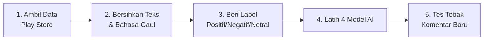

# Analisis Sentimen Ulasan Aplikasi Shopee di Google Play Store


## Tentang Apa Proyek Ini?

Bayangkan sebuah aplikasi besar seperti **Shopee** yang menerima **puluhan ribu komentar** setiap hari di Google Play Store. Jika tim perusahaan harus membaca puluhan ribu komentar tersebut satu per satu secara manual untuk mencari tahu apa keluhan pengguna, tentu akan memakan waktu yang sangat lama.

Proyek ini membangun **sistem kecerdasan buatan (AI)** yang mampu membaca dan mengelompokkan komentar pengguna Shopee secara otomatis ke dalam tiga kategori:
- **Positif:** Pengguna merasa puas (contoh: *"Pengiriman cepat, barang bagus!"*).
- **Negatif:** Pengguna mengeluh atau kecewa (contoh: *"Aplikasi sering error pas mau bayar"*).
- **Netral:** Komentar biasa yang tidak memuji maupun mengeluh.

---

## Masalah Bisnis yang Diselesaikan

1. **Komentar Terlalu Banyak untuk Dibaca Manual:** Ada puluhan ribu ulasan masuk, sehingga tim produk kesulitan menemukan keluhan utama dengan cepat.
2. **Bintang Rating Sering Tidak Sesuai Isi Komentar:** Banyak pengguna memberi bintang 5 tetapi isi komentarnya mengeluh, atau memberi bintang 1 padahal barangnya bagus. Karena itu, perusahaan perlu membaca isi tulisannya, bukan hanya menghitung jumlah bintang.
3. **Banyak Bahasa Gaul & Singkatan:** Komentar pengguna di Indonesia penuh dengan singkatan seperti *"bgt"*, *"gk"*, *"cod"*, atau *"ancur"* yang harus dirapikan lebih dulu agar bisa dipahami oleh komputer.

## Tujuan Proyek

1. **Mengumpulkan Data Nyata:** Mengambil **90.000 ulasan asli** pengguna Shopee dari Google Play Store (menghasilkan **58.300 ulasan bersih** yang siap diolah).
2. **Merapikan Bahasa Gaul Secara Otomatis:** Mengubah singkatan dan bahasa sehari-hari menjadi bahasa Indonesia baku agar komputer dapat memahami maksud kalimat.
3. **Menemukan Model AI Paling Akurat:** Membandingkan 4 metode AI yang berbeda hingga mendapatkan akurasi tebakan terbaik (**92,20%**).
4. **Siap Dipakai Menebak Komentar Baru:** Menyimpan model AI yang sudah pintar agar bisa langsung dipakai menebak komentar baru kapan saja.

---

## Gambaran Data yang Digunakan

Data diambil langsung dari ulasan aplikasi **Shopee Indonesia (`com.shopee.id`)** di Google Play Store:
- **Data Mentah:** `90.000` ulasan
- **Data Bersih (setelah membuang data kosong & ganda):** `58.300` ulasan

| Kategori Sentimen | Jumlah Ulasan | Persentase | Arti Sederhana |
| :--- | :--- | :--- | :--- |
| **Positif** | `28.901` | `49,57%` | Pengguna puas dengan aplikasi/belanja |
| **Negatif** | `25.730` | `44,13%` | Pengguna mengalami kendala atau kecewa |
| **Netral** | `3.669` | `6,29%` | Komentar umum / datar |
| **Total** | **58.300** | **100%** | |

---

## Cara Kerja Sistem (Langkah demi Langkah)



1. **Ambil Data (Scraping):** Mengunduh puluhan ribu ulasan Shopee dari Google Play Store secara otomatis.
2. **Bersihkan Teks:** Menghapus emoji, link, angka, tanda baca, serta mengubah kata gaul menjadi kata baku (contoh: *"bgt"* menjadi *"banget"*, *"gk"* menjadi *"tidak"*).
3. **Pemberian Label Sentimen:** Menghitung skor kata positif dan negatif di setiap komentar menggunakan kamus bahasa Indonesia.
4. **Pelatihan AI:** Melatih komputer menggunakan 4 metode berbeda untuk mengenali pola kalimat positif, negatif, dan netral.
5. **Uji Coba (Inferensi):** Memberikan kalimat baru untuk ditebak langsung oleh AI.

---

## Hasil Perbandingan 4 Model AI

Kami menguji 4 metode AI untuk melihat mana yang paling pintar menebak sentimen komentar:

| Peringkat | Nama Model AI | Tingkat Akurasi | Keterangan |
| :---: | :--- | :---: | :--- |
| **1** | **LSTM (Deep Learning)** | **92,20%** | **Paling Akurat** dalam memahami urutan kata |
| **2** | **Bidirectional GRU (Deep Learning)** | **92,11%** | Sangat akurat, membaca konteks kalimat dari dua arah |
| **3** | **Logistic Regression (Machine Learning)** | **91,37%** | Sangat cepat, ringan, dan langsung disimpan untuk uji coba |
| **4** | **Deep Neural Network / DNN** | **90,42%** | Akurasi tetap tinggi di atas 90% |

### Contoh Hasil Tebakan AI pada Kalimat Baru

| Kalimat Ulasan Pengguna | Hasil Tebakan AI |
| :--- | :--- |
| *"Saya sangat senang dengan produk ini!"* | **POSITIF** |
| *"Saya kecewa sama barangnya"* | **NEGATIF** |
| *"barang jelek gk sesuai"* | **NEGATIF** |
| *"banyak barangnya"* | **NETRAL** |

---

## Isi Folder Proyek

```text
Proyek Sentiment Analisis/
├── data/
│   └── ulasan_shoope.csv                                  # Data ulasan Shopee dari Play Store
├── model/
│   ├── Model_best_logistic.pkl                            # Model AI yang sudah dilatih & siap pakai
│   └── tfidf.pkl                                          # Alat pengubah teks menjadi angka
├── Azhar_Sentiment_Analysis_using_Machine_Learning.ipynb  # File utama proses pembersihan data & pelatihan 4 model AI
├── Scraping_Code.ipynb                                    # Kode untuk mengambil data ulasan dari Google Play Store
├── inference_Sentiment_Analysis.ipynb                     # Kode untuk mencoba menebak kalimat komentar baru
└── requirements.txt                                       # Daftar pustaka Python yang dibutuhkan
```

---

## Cara Mencoba Proyek Ini

### 1. Pasang Pustaka yang Dibutuhkan
```bash
pip install -r requirements.txt
pip install google-play-scraper sastrawi nltk scikit-learn tensorflow wordcloud joblib
```

### 2. Menjalankan Uji Coba Tebak Sentimen
Buka file `inference_Sentiment_Analysis.ipynb`, atau jalankan kode Python singkat berikut untuk menebak kalimat baru:

```python
import joblib

# 1. Muat model AI yang sudah dilatih
model = joblib.load("model/Model_best_logistic.pkl")
tfidf = joblib.load("model/tfidf.pkl")

# 2. Masukkan kalimat yang ingin ditebak
komentar_baru = [
    "Saya sangat senang dengan produk ini!",
    "Saya kecewa sama barangnya",
    "banyak barangnya"
]

# 3. Proses dan tampilkan hasil tebakan
fitur = tfidf.transform(komentar_baru).toarray()
probabilitas = model.predict_proba(fitur)

for kalimat, prob in zip(komentar_baru, probabilitas):
    if prob[1] > 0.5:
        hasil = "NETRAL"
    elif prob[2] > prob[0]:
        hasil = "POSITIF"
    else:
        hasil = "NEGATIF"
    print(f"Komentar: '{kalimat}' -> Sentimen: {hasil}")
```

---

## Penulis

**Azhar Zuhro**
- GitHub: [@azharzuhro12](https://github.com/azharzuhro12)
- LinkedIn: [Azhar Zuhro](https://www.linkedin.com/in/azhar-zuhro-927525225/)
