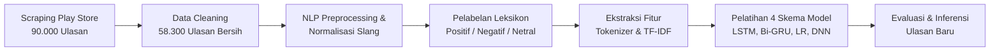

# Analisis Sentimen Ulasan Aplikasi Shopee di Google Play Store


Proyek **Natural Language Processing (NLP)** untuk menganalisis dan mengklasifikasikan sentimen ulasan pengguna aplikasi **Shopee Indonesia (`com.shopee.id`)** di Google Play Store ke dalam tiga kelas (**Positif**, **Negatif**, dan **Netral**) menggunakan perbandingan algoritma Deep Learning (**LSTM**, **Bidirectional GRU**, **DNN**) serta Machine Learning (**Logistic Regression**).

---

## Latar Belakang & Masalah Bisnis

Sebagai salah satu platform *e-commerce* dengan jumlah pengguna terbesar di Indonesia, aplikasi Shopee menerima puluhan ribu ulasan baru setiap hari di Google Play Store. Ulasan tersebut memuat umpan balik penting, mulai dari kepuasan belanja dan promo hingga keluhan teknis seperti aplikasi lambat (*lag*), kendala pembayaran, masalah pengiriman, maupun layanan pelanggan.

Masalah bisnis utama yang dihadapi adalah:
1. **Volume Ulasan yang Sangat Besar:** Memantau dan membaca puluhan ribu ulasan pengguna secara manual tidak efisien serta membutuhkan waktu operasional yang besar.
2. **Ketidaksesuaian Rating Bintang dengan Isi Komentar:** Banyak pengguna memberikan rating bintang yang tidak mencerminkan isi ulasan teks, sehingga metrik rata-rata bintang saja tidak cukup untuk mengukur kepuasan pengguna secara akurat.
3. **Banyaknya Kata Tidak Baku (Slang) Bahasa Indonesia:** Ulasan pengguna di Google Play Store didominasi singkatan dan bahasa percakapan sehari-hari (seperti *"bgt"*, *"gk"*, *"ancur"*, *"cod"*) yang memerlukan pipeline *preprocessing* NLP khusus sebelum dapat dianalisis secara otomatis.

## Tujuan Proyek

Proyek ini dibangun untuk menjawab permasalahan bisnis tersebut dengan sasaran berikut:
1. **Akuisisi Data Ulasan Skala Besar:** Mengambil data ulasan asli pengguna aplikasi Shopee Indonesia langsung dari Google Play Store menggunakan `google-play-scraper` (**90.000 ulasan mentah**, menghasilkan **58.300 ulasan bersih**).
2. **Standarisasi Preprocessing & Pelabelan Leksikon Bahasa Indonesia:** Membangun pipeline pembersihan teks, normalisasi kata *slang*, penghapusan *stopwords*, serta pelabelan polaritas otomatis berbasis kamus leksikon positif dan negatif Bahasa Indonesia.
3. **Eksperimen Multi-Arsitektur (Deep Learning & Machine Learning):** Membandingkan 4 skema pemodelan dengan kombinasi ekstraksi fitur **Word Embedding** dan **TF-IDF** untuk mendapatkan akurasi klasifikasi terbaik di atas 92%.
4. **Penyediaan Pipeline Inferensi Siap Pakai:** Menyimpan artefak model dan ekstraktor fitur (`Model_best_logistic.pkl` dan `tfidf.pkl`) agar dapat langsung digunakan untuk memprediksi sentimen teks ulasan baru.

---

## Informasi Dataset & Distribusi Sentimen

Data diambil dari ulasan Google Play Store untuk aplikasi **Shopee (`com.shopee.id`)** berbahasa Indonesia:
- **Total Data Hasil Scraping:** `90.000` baris (`11` kolom).
- **Total Data Bersih (Setelah Drop NaN & Duplikat):** `58.300` ulasan.

Berdasarkan hasil pelabelan menggunakan kamus leksikon Bahasa Indonesia, distribusi ketiga kelas sentimen adalah sebagai berikut:

| Kelas Sentimen | Jumlah Ulasan | Persentase |
| :--- | :--- | :--- |
| **Positif (`positive`)** | `28.901` | `49.57%` |
| **Negatif (`negative`)** | `25.730` | `44.13%` |
| **Netral (`neutral`)** | `3.669` | `6.29%` |
| **Total** | **58.300** | **100.00%** |

---

## Metodologi & Alur Kerja (Workflow)



### Tahapan Preprocessing Teks
1. **Text Cleaning (`cleaningText`)**: Menghapus *mention* (`@`), *hashtag* (`#`), tautan URL, angka, tanda baca, dan spasi berlebih.
2. **Case Folding (`casefoldingText`)**: Mengubah seluruh karakter menjadi huruf kecil (*lowercase*).
3. **Normalisasi Kata Slang (`fix_slangwords`)**: Mengonversi kata tidak baku atau singkatan Bahasa Indonesia ke bentuk baku menggunakan kamus *slang* (contoh: `"bgt" -> "banget"`, `"wtb" -> "beli"`, `"cod" -> "bayar ditempat"`).
4. **Tokenization (`tokenizingText`)**: Memecah kalimat menjadi daftar token kata menggunakan `nltk.tokenize.word_tokenize`.
5. **Stopword Removal (`filteringText`)**: Menghapus kata umum yang tidak memiliki bobot sentimen menggunakan gabungan *stopwords* Bahasa Indonesia, Bahasa Inggris (`NLTK`), serta daftar *stopwords* tambahan (`iya`, `yaa`, `gak`, `nya`, `sih`, `loh`, dll.).

---

## Skema Pemodelan & Hasil Evaluasi

Proyek ini menguji dan membandingkan **4 skema model** yang berbeda:

| Peringkat | Skema Model | Ekstraksi Fitur | Rasio Split (Train:Test) | Akurasi Test / Validasi |
| :---: | :--- | :--- | :---: | :---: |
| **1** | **Stacked LSTM** | Word Embedding (`max_words=5000`, `dim=128`) | 80 : 20 | **92.20%** (`0.9220`) |
| **2** | **Bidirectional GRU** | Word Embedding (`max_words=5000`, `dim=512`) | 80 : 20 | **92.11%** (`0.9211`) |
| **3** | **Logistic Regression (RandomizedSearchCV)** | TF-IDF (`max_features=2000`) | 70 : 30 | **91.37%** (`0.9137`) |
| **4** | **Deep Neural Network (DNN)** | TF-IDF (`max_features=5000`) | 80 : 20 | **90.42%** (`0.9042`) |

### Rincian Arsitektur Model
1. **Stacked LSTM (Model Terbaik - 92.20%):**
   - `Embedding(5000, 128)` -> `LSTM(128, return_sequences=True, dropout=0.2)` -> `LSTM(64, dropout=0.2)` -> `Dense(64, activation='relu')` -> `Dropout(0.5)` -> `BatchNormalization()` -> `Dense(3, activation='softmax')`.
2. **Bidirectional GRU (92.11%):**
   - `Embedding(5000, 512)` -> `SpatialDropout1D(0.3)` -> `Bidirectional(GRU(64, return_sequences=True))` -> `Bidirectional(GRU(128))` -> `Dense(128, ReLU, L2=0.01)` -> `Dropout(0.5)` -> `Dense(64, ReLU, L2=0.01)` -> `Dropout(0.5)` -> `Dense(3, Softmax)`.
3. **Logistic Regression + RandomizedSearchCV (91.37%):**
   - Pencarian *hyperparameter* terbaik menggunakan 3-fold cross-validation menghasilkan parameter optimal `C=8.3344`, `solver='saga'`, `max_iter=1000` (Akurasi Train: `93.61%`, Akurasi Test: `91.37%`).
4. **Deep Neural Network / DNN (90.42%):**
   - `Dense(512, ReLU)` -> `Dropout(0.5)` -> `Dense(256, ReLU)` -> `Dropout(0.5)` -> `Dense(128, ReLU)` -> `Dropout(0.5)` -> `Dense(3, Softmax)`.

---

## Struktur Direktori

```text
Proyek Sentiment Analisis/
├── data/
│   └── ulasan_shoope.csv                              # Dataset hasil scraping ulasan Shopee
├── model/
│   ├── Model_best_logistic.pkl                        # Artefak model Logistic Regression hasil tuning
│   └── tfidf.pkl                                      # Artefak TfidfVectorizer yang telah di-fit
├── Azhar_Sentiment_Analysis_using_Machine_Learning.ipynb  # Notebook utama (Preprocessing, EDA, WordCloud, 4 Model)
├── Scraping_Code.ipynb                                # Notebook khusus pengambilan data Google Play Store
├── inference_Sentiment_Analysis.ipynb                 # Notebook pengujian prediksi sentimen pada kalimat baru
└── requirements.txt                                   # Daftar dependensi pustaka Python
```

---

## Cara Menjalankan Proyek

### 1. Instalasi Dependensi
```bash
pip install -r requirements.txt
pip install google-play-scraper sastrawi nltk scikit-learn tensorflow wordcloud joblib
```

### 2. Pengambilan Data (Opsional)
Jalankan `Scraping_Code.ipynb` untuk mengambil data ulasan terbaru dari Google Play Store:
```python
from google_play_scraper import Sort, reviews_all

scrapreview = reviews_all(
    "com.shopee.id",
    lang="id",
    country="id",
    sort=Sort.MOST_RELEVANT,
    count=10000
)
```

### 3. Pelatihan & Evaluasi Model
Buka dan jalankan `Azhar_Sentiment_Analysis_using_Machine_Learning.ipynb` untuk mengeksekusi pipeline pembersihan teks, visualisasi *WordCloud* tiap sentimen, hingga pelatihan keempat model.

### 4. Inferensi pada Kalimat Baru
Jalankan `inference_Sentiment_Analysis.ipynb` atau gunakan potongan kode berikut untuk memprediksi sentimen ulasan baru menggunakan model yang tersimpan di folder `model/`:

```python
import joblib

best_model = joblib.load("model/Model_best_logistic.pkl")
tfidf = joblib.load("model/tfidf.pkl")

ulasan_baru = [
    "Saya sangat senang dengan produk ini!",
    "Saya kecewa sama barangnya",
    "banyak barangnya"
]

X_input = tfidf.transform(ulasan_baru).toarray()
probabilitas = best_model.predict_proba(X_input)

for kalimat, prob in zip(ulasan_baru, probabilitas):
    if prob[1] > 0.5:
        sentimen = "NETRAL"
    elif prob[2] > prob[0]:
        sentimen = "POSITIF"
    else:
        sentimen = "NEGATIF"
    print(f"Ulasan: {kalimat} -> Sentimen: {sentimen}")
```

---

## Penulis

**Azhar Zuhro**
- GitHub: [@azharzuhro12](https://github.com/azharzuhro12)
- LinkedIn: [Azhar Zuhro](https://www.linkedin.com/in/azhar-zuhro-927525225/)
