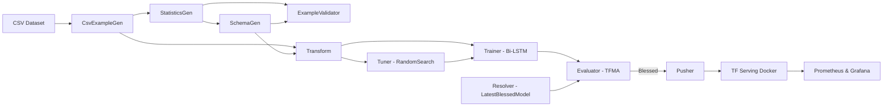

# End-to-End MLOps Pipeline: Sentiment Analysis with TFX, Docker, Prometheus & Grafana

Proyek ini mengimplementasikan pipeline **Machine Learning Operations (MLOps)** end-to-end untuk klasifikasi sentimen teks (Tweet Sentiment Analysis) menggunakan **TensorFlow Extended (TFX)**, **Apache Beam**, **TensorFlow Serving**, **Docker**, **Prometheus**, dan **Grafana**.

Seluruh siklus hidup model diotomatisasi mulai dari *data ingestion*, validasi skema, *feature engineering*, *hyperparameter tuning*, pelatihan model (*Bi-LSTM*), evaluasi berbasis ambang batas (*model blessing* dengan TFMA), hingga *containerized serving* dan pemantauan metrik produksi secara *real-time*.

---

## Arsitektur Pipeline MLOps



### Komponen TFX yang Digunakan
1. **CsvExampleGen**: Membaca dataset `data/sentiment_analysis.csv` dan membaginya secara otomatis menjadi *train split* (80%) dan *eval split* (20%) menggunakan *hash buckets* (8:2).
2. **StatisticsGen**: Menghitung statistik deskriptif dari setiap fitur pada dataset.
3. **SchemaGen**: Menyusun skema tipe data dan batasan nilai fitur secara otomatis berdasarkan hasil statistik.
4. **ExampleValidator**: Mendeteksi anomali data, nilai kosong (*missing values*), dan penyimpangan distribusi terhadap skema.
5. **Transform (`modules/transform.py`)**: Melakukan *preprocessing* teks (`tf.strings.lower`) pada fitur `tweet` dan konversi tipe label (`tf.int64`) menggunakan `tensorflow_transform` (TFT). Grafik transformasi disimpan bersama model untuk mencegah *training-serving skew*.
6. **Tuner (`modules/tuner.py`)**: Mencari kombinasi *hyperparameter* terbaik menggunakan `keras_tuner.RandomSearch` (`max_trials=4`, objektif `binary_accuracy`).
7. **Trainer (`modules/trainer.py`)**: Melatih jaringan saraf **Bidirectional LSTM** dengan parameter hasil *tuning* dan mengekspor model ke format `SavedModel` beserta *serving signature* untuk menerima payload `tf.train.Example`.
8. **Resolver & Evaluator (`modules/components.py`)**: Membandingkan performa model baru dengan *baseline model* menggunakan **TensorFlow Model Analysis (TFMA)**. Model hanya diloloskan (*blessed*) apabila memenuhi ambang batas `BinaryAccuracy >= 0.5` dan lebih unggul dari model sebelumnya.
9. **Pusher**: Mendistribusikan model yang telah lolos evaluasi ke direktori `serving_model_dir/azharzuhro-detection-model`.

---

## Arsitektur Model & Hyperparameter Tuning

Model klasifikasi biner dibangun menggunakan TensorFlow/Keras dengan susunan layer sebagai berikut:
- **Input Layer**: Menerima string mentah (`tweet_xf`) berdimensi `(1,)`.
- **TextVectorization**: Tokenisasi teks dengan `max_tokens=5000` dan `output_sequence_length=500`.
- **Embedding Layer**: Merepresentasikan token ke dalam vektor padat (`embed_dims`: `16` - `128`, step `32`).
- **Bidirectional LSTM**: Menangkap konteks urutan kata dua arah (`lstm_units`: `32` - `128`, step `32`).
- **Hidden Dense + Dropout Layers**: `1` atau `2` layer Dense (`32` - `256` unit, aktivasi ReLU) diikuti Dropout (`0.1` - `0.5`).
- **Output Layer**: `Dense(1, activation='sigmoid')` dengan *optimizer* Adam (`learning_rate`: `1e-2`, `1e-3`, `1e-4`) dan *loss function* `BinaryCrossentropy`.

### Hasil Evaluasi Model
| Metrik | Nilai |
| :--- | :--- |
| **Binary Accuracy** | **97.16%** (`0.9716`) |
| **Binary Crossentropy Loss** | `0.0897` |
| **AUC** | `0.73` (`73%`) |

---

## Struktur Direktori

```text
proyek MLops/
├── config/
│   └── prometheus.config          # Konfigurasi endpoint metrik Prometheus untuk TF Serving
├── data/
│   └── sentiment_analysis.csv     # Dataset utama analisis sentimen
├── modules/
│   ├── components.py              # Definisi dan koneksi komponen pipeline TFX
│   ├── transform.py               # Preprocessing fitur dengan TensorFlow Transform
│   ├── tuner.py                   # Hyperparameter tuning dengan KerasTuner RandomSearch
│   └── trainer.py                 # Arsitektur Bi-LSTM, training loop, dan ekspor SavedModel
├── monitoring/
│   ├── Dockerfile                 # Image Docker untuk server Prometheus
│   └── prometheus.yml             # Konfigurasi scrape interval (5s) ke endpoint TF Serving
├── serving_model_dir/             # Direktori output model yang telah lolos evaluasi (Pusher)
├── Dockerfile                     # Image Docker TensorFlow Serving dengan Prometheus monitoring
├── pipeline.py                    # Inisialisasi TFX Pipeline Orchestrator & Apache Beam args
├── notebook.ipynb                 # Eksekusi end-to-end pipeline TFX dengan BeamDagRunner
├── check_tf_serving.ipynb         # Pemeriksaan status kesehatan model pada endpoint TF Serving
├── test_notebook.ipynb            # Pengujian request prediksi dengan serialized tf.train.Example
└── laporan proyek.md              # Ringkasan laporan teknis submission
```

---

## Cara Menjalankan Proyek

### 1. Menjalankan Pipeline TFX
Jalankan seluruh sel pada `notebook.ipynb` untuk mengeksekusi pipeline menggunakan `BeamDagRunner`:

```python
from tfx.orchestration.beam.beam_dag_runner import BeamDagRunner
from modules import components
import pipeline

main_components = components.init_components({
    "data_root": "data",
    "transform_module_file_path": "modules/transform.py",
    "trainer_module_file_path": "modules/trainer.py",
    "tuner_module_file_path": "modules/tuner.py",
    "serving_directory": "serving_model_dir/azharzuhro-detection-model"
})

tfx_pipeline = pipeline.init_pipeline_orchestrator(
    main_components,
    pipeline_root="azharzuhro-pipelines/azharzuhro-detection-pipeline",
    pipeline_name="azharzuhro-detection-pipeline",
    metadata_path="azharzuhro-pipelines/azharzuhro-detection-pipeline/metadata.sqlite",
)

BeamDagRunner().run(tfx_pipeline)
```

### 2. Menjalankan Model Serving dengan Docker
Bangun dan jalankan container **TensorFlow Serving** yang telah dilengkapi konfigurasi metrik Prometheus:

```bash
docker build -t sentiment-tf-serving .
docker run -d -p 8500:8500 -p 8501:8501 --name tf-serving sentiment-tf-serving
```

Verifikasi status ketersediaan model:
```bash
curl http://localhost:8501/v1/models/cc-model
```

### 3. Menguji Endpoint Prediksi (REST API)
Kirim permintaan inferensi menggunakan payload `tf.train.Example` ter-serialisasi (lihat `test_notebook.ipynb`):

```python
import base64
import json
import requests
import tensorflow as tf

def prepare_example(tweet: str) -> str:
    feature = {
        "tweet": tf.train.Feature(bytes_list=tf.train.BytesList(value=[tweet.encode()]))
    }
    example = tf.train.Example(features=tf.train.Features(feature=feature))
    serialized = example.SerializeToString()
    return json.dumps({
        "signature_name": "serving_default",
        "instances": [{"b64": base64.b64encode(serialized).decode()}]
    })

response = requests.post(
    "http://localhost:8501/v1/models/cc-model:predict",
    data=prepare_example("beautiful")
)
predictions = response.json().get("predictions")
label = "positif" if predictions[0][0] > 0.6 else "negatif"
print(f"Hasil prediksi: {label} (skor: {predictions[0][0]:.4f})")
```

### 4. Menjalankan Monitoring (Prometheus & Grafana)
Bangun dan jalankan container Prometheus pada folder `monitoring/`:

```bash
cd monitoring
docker build -t tf-serving-prometheus .
docker run -d -p 9090:9090 --name prometheus tf-serving-prometheus
```
Hubungkan **Grafana** ke sumber data Prometheus (`http://localhost:9090`) untuk memantau metrik request, latensi, serta kesehatan layanan inferensi.

---

## Dokumentasi Deployment & Monitoring

### Status Model Serving


### Endpoint Metrik Monitoring


### Prometheus Targets & Scraping


### Grafana Observability Dashboard


---

## Lisensi & Penulis
Dikembangkan oleh **Azhar Zuhro** sebagai bagian dari pengembangan sistem **Machine Learning Operations (MLOps)**.
