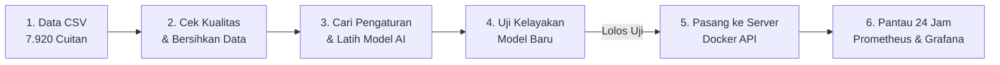

# Otomatisasi Pipeline AI (MLOps): Deteksi Keluhan Pelanggan Produk Teknologi


## Tentang Apa Proyek Ini?

Membuat model kecerdasan buatan (AI) yang pintar membaca keluhan pelanggan saja belum cukup jika model tersebut hanya berjalan di laptop pembuatnya. Agar bisa dipakai oleh perusahaan setiap hari, model AI membutuhkan **"jalur pabrik otomatis" (disebut MLOps)**.

Proyek ini membangun sistem otomatis dari hulu ke hilir yang bertugas:
1. **Membaca ribuan cuitan (tweet) pelanggan** tentang produk teknologi (seperti Apple, Samsung, Sony, dan Android).
2. **Melatih dan menguji model AI secara otomatis** untuk membedakan mana cuitan yang berisi **Apresiasi/Positif** dan mana yang berisi **Keluhan/Negatif**.
3. **Menyediakan layanan API siap pakai** (menggunakan Docker) sekaligus **layar pemantau kesehatan sistem 24 jam** (menggunakan Prometheus & Grafana).

---

## Masalah Bisnis yang Diselesaikan

Perusahaan teknologi menerima ribuan komentar dan keluhan pelanggan setiap hari di media sosial (Twitter/X), mulai dari masalah baterai boros, *error* setelah *update software*, hingga layar rusak.

1. **Sulit Memilah Komplain Secara Manual:** Tim *Customer Support* kewalahan jika harus membaca ribuan cuitan satu per satu untuk mencari pelanggan yang sedang mengalami masalah serius.
2. **Respons Lambat Merugikan Reputasi Brand:** Jika keluhan massal (misalnya *bug* aplikasi) terlambat disadari, pelanggan bisa berpindah ke produk pesaing.
3. **Model AI Sering Rusak Saat Dipakai di Dunia Nyata:** Banyak model AI yang akurat saat uji coba, tetapi gagal bekerja saat dipasang di server perusahaan karena tidak ada sistem pengecekan kualitas dan pemantauan otomatis.

## Tujuan Proyek

1. **Deteksi Otomatis Keluhan Pelanggan:** Membangun model AI (**Bidirectional LSTM**) yang mampu mengenali cuitan positif maupun keluhan pelanggan dengan **akurasi 97,16%**.
2. **Otomatisasi Proses Pelatihan AI (TFX Pipeline):** Membuat alur kerja otomatis mulai dari pemeriksaan data, pembersihan teks, pencarian pengaturan AI terbaik, hingga pengujian kualitas model.
3. **Seleksi Kualitas Otomatis (Quality Gate):** Memastikan hanya model AI yang lolos standar akurasi yang boleh naik ke server produksi.
4. **Siap Diakses & Dipantau Real-Time:** Membungkus model AI ke dalam container **Docker** agar mudah dipasang di server mana saja, lengkap dengan pemantauan kinerja lewat **Prometheus** dan **Grafana**.

---

## Gambaran Data yang Digunakan

Dataset diambil dari [Sentiment Analysis Dataset](https://www.kaggle.com/datasets/dineshpiyasamara/sentiment-analysis-dataset) (`data/sentiment_analysis.csv`) yang berisi **7.920 cuitan pelanggan** produk elektronik dan *smartphone*:

| Label | Kategori | Jumlah Data | Contoh Isi Cuitan Pelanggan |
| :---: | :--- | :---: | :--- |
| **`0`** | **Sentimen Positif** | `5.894` | Pelanggan senang dengan fitur kamera, desain, atau pembelian baru |
| **`1`** | **Sentimen Negatif / Keluhan** | `2.026` | Komplain baterai cepat habis, *crash* usai *update*, atau layanan pelanggan buruk |
| **Total** | | **7.920** | Dibagi menjadi **80% Data Latih** dan **20% Data Uji** |

---

## Alur Kerja Otomatis (Pipeline MLOps)



Penjelasan sederhana tiap komponen otomatis di dalam sistem (**TensorFlow Extended / TFX**):

| Tahap | Nama Komponen | Tugasnya dalam Bahasa Sederhana |
| :--- | :--- | :--- |
| **1. Baca Data** | `CsvExampleGen` | Membaca file CSV dan membagi data menjadi 80% untuk belajar dan 20% untuk ujian. |
| **2. Cek Data** | `StatisticsGen`, `SchemaGen`, `ExampleValidator` | Memeriksa apakah ada data yang rusak, kosong, atau salah format sebelum dipelajari AI. |
| **3. Rapikan Teks** | `Transform` | Merapikan huruf besar/kecil pada teks cuitan secara konsisten. |
| **4. Cari Setelan Terbaik** | `Tuner` | Mencoba beberapa kombinasi pengaturan (*hyperparameter*) agar AI mencapai akurasi tertinggi. |
| **5. Latih AI** | `Trainer` | Melatih jaringan saraf **Bidirectional LSTM** menggunakan setelan terbaik. |
| **6. Uji Kelayakan** | `Resolver` & `Evaluator` | Menguji model AI baru. Jika akurasinya di bawah standar atau kalah dari model lama, model ditolak. |
| **7. Rilis Model** | `Pusher` | Jika lolos ujian, model otomatis dikirim ke folder produksi untuk dijalankan oleh server. |

---

## Performa Model AI

Model dibangun menggunakan arsitektur **Bidirectional LSTM** (membaca konteks kalimat dari depan ke belakang dan sebaliknya) dengan hasil pengujian sebagai berikut:

| Ukuran Performa | Hasil | Arti Sederhana |
| :--- | :--- | :--- |
| **Binary Accuracy** | **97,16%** | Dari 100 cuitan, model berhasil menebak sekitar 97 cuitan dengan tepat. |
| **Loss (Tingkat Kesalahan)** | `0,0897` | Semakin mendekati 0 berarti tingkat kesalahan prediksi semakin kecil. |
| **Skor AUC** | `0,7300` (`73%`) | Kemampuan model dalam membedakan kelas positif dan keluhan. |

---

## Isi Folder Proyek

```text
proyek MLops/
├── config/
│   └── prometheus.config          # Pengaturan agar server AI bisa mengirim data ke alat pemantau
├── data/
│   └── sentiment_analysis.csv     # Data 7.920 cuitan pelanggan produk teknologi
├── modules/
│   ├── components.py              # Pengaturan urutan kerja pipeline otomatis (TFX)
│   ├── transform.py               # Kode untuk merapikan teks cuitan
│   ├── tuner.py                   # Kode untuk mencari pengaturan model AI terbaik
│   └── trainer.py                 # Kode arsitektur model AI (Bi-LSTM) dan proses pelatihannya
├── monitoring/
│   ├── Dockerfile                 # Pembungkus server pemantau Prometheus
│   └── prometheus.yml             # Pengaturan jadwal pengecekan server setiap 5 detik
├── serving_model_dir/             # Tempat penyimpanan model AI yang sudah lolos uji kelayakan
├── Dockerfile                     # Pembungkus model AI menjadi layanan server (TensorFlow Serving)
├── pipeline.py                    # Penggerak utama pipeline otomatis
├── notebook.ipynb                 # File untuk menjalankan seluruh proses otomatis dari awal sampai akhir
├── check_tf_serving.ipynb         # File untuk mengecek apakah server AI sudah menyala
└── test_notebook.ipynb            # File untuk mencoba mengirim teks cuitan ke server AI
```

---

## Cara Menjalankan Proyek

### 1. Menjalankan Pipeline Pelatihan Otomatis
Buka dan jalankan seluruh sel di dalam `notebook.ipynb`. Sistem akan otomatis membaca data, melatih AI, menguji akurasinya, dan menyimpan model terbaik.

### 2. Menyalakan Server AI dengan Docker
Jalankan perintah ini di terminal untuk menyalakan server prediksi AI:
```bash
docker build -t sentiment-tf-serving .
docker run -d -p 8500:8500 -p 8501:8501 --name tf-serving sentiment-tf-serving
```

Cek apakah server sudah aktif:
```bash
curl http://localhost:8501/v1/models/cc-model
```

### 3. Mencoba Mengirim Cuitan ke Server AI
Lihat file `test_notebook.ipynb` atau gunakan kode Python berikut untuk mengetes prediksi:
```python
import base64
import json
import requests
import tensorflow as tf

def siapkan_data(teks_tweet: str) -> str:
    fitur = {"tweet": tf.train.Feature(bytes_list=tf.train.BytesList(value=[teks_tweet.encode()]))}
    contoh = tf.train.Example(features=tf.train.Features(feature=fitur))
    return json.dumps({
        "signature_name": "serving_default",
        "instances": [{"b64": base64.b64encode(contoh.SerializeToString()).decode()}]
    })

# Kirim teks cuitan ke server AI
respons = requests.post(
    "http://localhost:8501/v1/models/cc-model:predict",
    data=siapkan_data("The battery drains so fast after the update!")
)
skor = respons.json()["predictions"][0][0]
hasil = "Negatif / Keluhan" if skor > 0.6 else "Positif"
print(f"Hasil Deteksi: {hasil} (Skor: {skor:.4f})")
```

### 4. Menyalakan Sistem Pemantau (Prometheus)
```bash
cd monitoring
docker build -t tf-serving-prometheus .
docker run -d -p 9090:9090 --name prometheus tf-serving-prometheus
```

---

## Penulis

**Azhar Zuhro**
- GitHub: [@azharzuhro12](https://github.com/azharzuhro12)
- LinkedIn: [Azhar Zuhro](https://www.linkedin.com/in/azhar-zuhro-927525225/)
