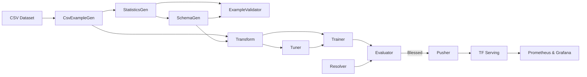

# End-to-End MLOps Pipeline for Sentiment Analysis


An automated Machine Learning Operations (MLOps) pipeline for binary text sentiment classification built with **TensorFlow Extended (TFX)**, **Apache Beam**, **TensorFlow Serving**, **Docker**, **Prometheus**, and **Grafana**.

This project automates the complete machine learning lifecycle: data ingestion, schema validation, preprocessing with TensorFlow Transform, hyperparameter tuning, Bidirectional LSTM training, threshold-based model validation with TFMA, containerized serving, and real-time production monitoring.

---

## Pipeline Architecture



| Stage | Component | Responsibility |
| :--- | :--- | :--- |
| **1. Ingestion** | `CsvExampleGen` | Ingests `data/sentiment_analysis.csv` and partitions data into 80% train and 20% evaluation splits using hash buckets (8:2). |
| **2. Statistics** | `StatisticsGen` | Computes descriptive statistics across all dataset records. |
| **3. Schema** | `SchemaGen` | Infers feature types, domains, and presence constraints (`tweet`, `label`). |
| **4. Validation** | `ExampleValidator` | Detects data anomalies, missing values, and schema drift before training. |
| **5. Preprocessing** | `Transform` | Normalizes raw text (`tf.strings.lower`) and casts label types (`tf.int64`) via `tensorflow_transform` (`tft`), exporting a preprocessing graph attached to the model to prevent training-serving skew. |
| **6. Tuning** | `Tuner` | Runs `keras_tuner.RandomSearch` (`max_trials=4`) to optimize embedding dimensions, LSTM units, hidden layers, dropout rate, and learning rate. |
| **7. Training** | `Trainer` | Trains a **Bidirectional LSTM** network using the best hyperparameters and exports a `SavedModel` with a serialized `tf.train.Example` serving signature. |
| **8. Evaluation** | `Resolver` + `Evaluator` | Compares the candidate model against the latest blessed baseline using **TensorFlow Model Analysis (TFMA)**. Models must exceed `BinaryAccuracy >= 0.5` and outperform the active baseline. |
| **9. Deployment** | `Pusher` | Pushes blessed models to `serving_model_dir/azharzuhro-detection-model` for production serving. |

---

## Model Specification & Performance

### Neural Architecture
- **Input**: Raw string feature (`tweet_xf`, shape `(1,)`).
- **TextVectorization**: Vocabulary size `5,000`, sequence length `500`.
- **Embedding**: Tuned between `16` and `128` dimensions (step `32`).
- **Bidirectional LSTM**: Tuned between `32` and `128` units (step `32`).
- **Classification Head**: `1` to `2` Dense layers (`32` to `256` units, ReLU) with Dropout (`0.1` to `0.5`), followed by `Dense(1, activation="sigmoid")`.
- **Optimization**: Adam optimizer (`1e-2`, `1e-3`, `1e-4`) with `BinaryCrossentropy` loss and `EarlyStopping` (`patience=10`).

### Evaluation Results (TFMA)
| Metric | Value |
| :--- | :--- |
| **Binary Accuracy** | **97.16%** (`0.9716`) |
| **Loss (Binary Crossentropy)** | `0.0897` |
| **AUC** | `0.7300` |

---

## Repository Structure

```text
proyek MLops/
├── config/
│   └── prometheus.config          # Prometheus metrics endpoint config for TF Serving
├── data/
│   └── sentiment_analysis.csv     # Source dataset (tweet & binary sentiment label)
├── modules/
│   ├── components.py              # TFX component definitions and DAG wiring
│   ├── transform.py               # TensorFlow Transform preprocessing function
│   ├── tuner.py                   # KerasTuner RandomSearch hyperparameter tuning
│   └── trainer.py                 # Bi-LSTM architecture, training loop, and serving signature
├── monitoring/
│   ├── Dockerfile                 # Prometheus server container definition
│   └── prometheus.yml             # Scrape config targeting TF Serving metrics endpoint
├── serving_model_dir/             # Blessed SavedModel artifacts exported by Pusher
├── Dockerfile                     # TensorFlow Serving container with Prometheus config
├── pipeline.py                    # TFX Pipeline orchestrator with Apache Beam & SQLite metadata
├── notebook.ipynb                 # End-to-end pipeline execution via BeamDagRunner
├── check_tf_serving.ipynb         # Model availability check against TF Serving REST API
└── test_notebook.ipynb            # Client script for serialized tf.train.Example inference
```

---

## Getting Started

### 1. Run the TFX Pipeline
Execute `notebook.ipynb` or run the orchestrator directly via Apache Beam:

```python
from tfx.orchestration.beam.beam_dag_runner import BeamDagRunner
from modules import components
import pipeline

components_list = components.init_components({
    "data_root": "data",
    "transform_module_file_path": "modules/transform.py",
    "trainer_module_file_path": "modules/trainer.py",
    "tuner_module_file_path": "modules/tuner.py",
    "serving_directory": "serving_model_dir/azharzuhro-detection-model",
})

tfx_pipeline = pipeline.init_pipeline_orchestrator(
    components=components_list,
    pipeline_root="azharzuhro-pipelines/azharzuhro-detection-pipeline",
    pipeline_name="azharzuhro-detection-pipeline",
    metadata_path="azharzuhro-pipelines/azharzuhro-detection-pipeline/metadata.sqlite",
)

BeamDagRunner().run(tfx_pipeline)
```

### 2. Deploy Model with TensorFlow Serving (Docker)
Build and start the serving container exposing gRPC (`8500`) and REST API (`8501`):

```bash
docker build -t sentiment-tf-serving .
docker run -d -p 8500:8500 -p 8501:8501 --name tf-serving sentiment-tf-serving
```

Check model status:
```bash
curl http://localhost:8501/v1/models/cc-model
```

### 3. Run Inference via REST API
Send a base64-encoded serialized `tf.train.Example` payload to the `/v1/models/cc-model:predict` endpoint:

```python
import base64
import json
import requests
import tensorflow as tf

def prepare_example(tweet: str) -> str:
    feature = {
        "tweet": tf.train.Feature(bytes_list=tf.train.BytesList(value=[tweet.encode()]))
    }
    example = tf.train.Example(features=tf.train.Features(feature=feature))
    serialized = example.SerializeToString()
    return json.dumps({
        "signature_name": "serving_default",
        "instances": [{"b64": base64.b64encode(serialized).decode()}]
    })

response = requests.post(
    "http://localhost:8501/v1/models/cc-model:predict",
    data=prepare_example("The service and product quality were outstanding!")
)
score = response.json()["predictions"][0][0]
sentiment = "Positive" if score > 0.6 else "Negative"
print(f"Sentiment: {sentiment} (Confidence: {score:.4f})")
```

### 4. Start Prometheus & Grafana Monitoring
Build and run the Prometheus container to scrape `/monitoring/prometheus/metrics` from TensorFlow Serving:

```bash
cd monitoring
docker build -t tf-serving-prometheus .
docker run -d -p 9090:9090 --name prometheus tf-serving-prometheus
```

---

## Author

**Azhar Zuhro**
- GitHub: [@azharzuhro12](https://github.com/azharzuhro12)
- LinkedIn: [Azhar Zuhro](https://www.linkedin.com/in/azhar-zuhro-927525225/)
