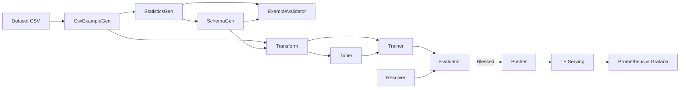

# End-to-End MLOps Pipeline: Analisis Sentimen dengan TFX, Docker, Prometheus & Grafana


Implementasi pipeline **Machine Learning Operations (MLOps)** end-to-end untuk klasifikasi sentimen teks menggunakan **TensorFlow Extended (TFX)**, **Apache Beam**, **TensorFlow Serving**, **Docker**, **Prometheus**, dan **Grafana**.

---

## Latar Belakang Masalah

Model analisis sentimen yang dikembangkan secara manual di lingkungan eksperimen (*notebook*) sering kali menghadapi kendala ketika harus dijalankan di lingkungan produksi, antara lain:
1. **Inkonsistensi Data & Skema:** Perubahan format data, nilai kosong (*missing values*), atau anomali pada data baru dapat menurunkan akurasi model tanpa terdeteksi.
2. **Training-Serving Skew:** Perbedaan cara *preprocessing* teks saat pelatihan dan saat model menerima input di API produksi sering memicu kesalahan prediksi.
3. **Proses Validasi & Deployment Manual:** Membandingkan performa model baru terhadap model lama serta memperbarui layanan inferensi secara manual memakan waktu dan rawan kesalahan.
4. **Minimnya Observabilitas Produksi:** Tanpa pemantauan metrik secara *real-time*, sulit untuk mengetahui beban *request*, latensi inferensi, maupun status kesehatan layanan model.

## Tujuan Proyek

Proyek ini bertujuan untuk membangun sistem MLOps yang terotomatisasi dan siap produksi dengan sasaran berikut:
1. **Otomatisasi Siklus Hidup ML:** Mengintegrasikan tahapan *data ingestion*, validasi data, *feature engineering*, *hyperparameter tuning*, pelatihan model **Bidirectional LSTM**, hingga evaluasi ke dalam satu pipeline TFX yang terukur.
2. **Mencegah Training-Serving Skew:** Menyematkan grafik transformasi teks (`tensorflow_transform`) langsung ke dalam artefak `SavedModel` sehingga *preprocessing* berjalan identik di tahap pelatihan dan produksi.
3. **Quality Gate Otomatis (Model Blessing):** Memastikan hanya model yang memenuhi ambang batas evaluasi (**TensorFlow Model Analysis / TFMA**) dan mengungguli *baseline model* yang dapat didorong (*push*) ke produksi.
4. **Deployment & Monitoring Terkontainerisasi:** Menyajikan model melalui REST API menggunakan **TensorFlow Serving (Docker)** yang terhubung dengan **Prometheus** dan **Grafana** untuk pemantauan performa secara *real-time*.

---

## Arsitektur Pipeline



| Tahap | Komponen TFX | Fungsi Utama |
| :--- | :--- | :--- |
| **1. Ingestion** | `CsvExampleGen` | Membaca dataset `data/sentiment_analysis.csv` dan membaginya menjadi 80% data latih (*train*) serta 20% data evaluasi (*eval*) menggunakan *hash buckets* (8:2). |
| **2. Statistics** | `StatisticsGen` | Menghitung statistik deskriptif untuk seluruh fitur pada dataset. |
| **3. Schema** | `SchemaGen` | Menyusun skema tipe data dan batasan domain fitur (`tweet`, `label`) secara otomatis. |
| **4. Validation** | `ExampleValidator` | Mendeteksi anomali data, nilai kosong, dan penyimpangan distribusi terhadap skema sebelum pelatihan dimulai. |
| **5. Preprocessing** | `Transform` | Menormalisasi teks (`tf.strings.lower`) dan mengubah tipe label (`tf.int64`) melalui `tensorflow_transform` (`tft`), serta mengekspor grafik transformasi ke dalam model. |
| **6. Tuning** | `Tuner` | Menjalankan `keras_tuner.RandomSearch` (`max_trials=4`) untuk mencari kombinasi dimensi *embedding*, unit LSTM, jumlah *hidden layer*, *dropout*, dan *learning rate* terbaik. |
| **7. Training** | `Trainer` | Melatih jaringan **Bidirectional LSTM** menggunakan *hyperparameter* terbaik dan mengekspor `SavedModel` dengan *serving signature* `tf.train.Example`. |
| **8. Evaluation** | `Resolver` + `Evaluator` | Membandingkan kandidat model dengan *baseline model* aktif menggunakan **TFMA**. Model wajib melampaui `BinaryAccuracy >= 0.5` dan lebih unggul dari *baseline*. |
| **9. Deployment** | `Pusher` | Mengirim model yang telah lolos validasi (*blessed*) ke direktori `serving_model_dir/azharzuhro-detection-model`. |

---

## Spesifikasi Model & Hasil Evaluasi

### Arsitektur Jaringan Saraf (Bi-LSTM)
- **Input Layer**: Menerima fitur teks mentah (`tweet_xf`, dimensi `(1,)`).
- **TextVectorization**: Ukuran kosakata `5.000` token dengan panjang sekuens `500`.
- **Embedding Layer**: Dimensi vektor hasil *tuning* antara `16` hingga `128` (kelipatan `32`).
- **Bidirectional LSTM**: Menangkap konteks urutan kata dua arah (`32` hingga `128` unit, kelipatan `32`).
- **Classification Head**: `1` hingga `2` layer Dense (`32` hingga `256` unit, aktivasi ReLU) dengan Dropout (`0.1` hingga `0.5`), diakhiri layer output `Dense(1, activation="sigmoid")`.
- **Optimisasi**: Optimizer Adam (`1e-2`, `1e-3`, `1e-4`), *loss function* `BinaryCrossentropy`, dan `EarlyStopping` (`patience=10`).

### Performa Model (Evaluasi TFMA)
| Metrik Evaluasi | Nilai |
| :--- | :--- |
| **Binary Accuracy** | **97.16%** (`0.9716`) |
| **Loss (Binary Crossentropy)** | `0.0897` |
| **AUC** | `0.7300` (`73%`) |

---

## Struktur Direktori

```text
proyek MLops/
├── config/
│   └── prometheus.config          # Konfigurasi endpoint metrik Prometheus pada TF Serving
├── data/
│   └── sentiment_analysis.csv     # Dataset sumber (teks tweet & label sentimen biner)
├── modules/
│   ├── components.py              # Definisi komponen TFX dan konfigurasi evaluasi TFMA
│   ├── transform.py               # Fungsi preprocessing teks dengan TensorFlow Transform
│   ├── tuner.py                   # Pencarian hyperparameter dengan KerasTuner RandomSearch
│   └── trainer.py                 # Arsitektur Bi-LSTM, pelatihan model, dan serving signature
├── monitoring/
│   ├── Dockerfile                 # Definisi container untuk server Prometheus
│   └── prometheus.yml             # Konfigurasi scraping metrik ke endpoint TF Serving
├── serving_model_dir/             # Artefak SavedModel yang telah lolos evaluasi (Pusher)
├── Dockerfile                     # Container TensorFlow Serving dengan dukungan Prometheus
├── pipeline.py                    # Orchestrator pipeline TFX (Apache Beam & SQLite metadata)
├── notebook.ipynb                 # Eksekusi end-to-end pipeline TFX dengan BeamDagRunner
├── check_tf_serving.ipynb         # Pemeriksaan status kesehatan model pada REST API
└── test_notebook.ipynb            # Pengujian inferensi klien dengan payload tf.train.Example
```

---

## Panduan Menjalankan Proyek

### 1. Menjalankan Pipeline TFX
Jalankan seluruh sel pada `notebook.ipynb` atau eksekusi *orchestrator* melalui Apache Beam:

```python
from tfx.orchestration.beam.beam_dag_runner import BeamDagRunner
from modules import components
import pipeline

components_list = components.init_components({
    "data_root": "data",
    "transform_module_file_path": "modules/transform.py",
    "trainer_module_file_path": "modules/trainer.py",
    "tuner_module_file_path": "modules/tuner.py",
    "serving_directory": "serving_model_dir/azharzuhro-detection-model",
})

tfx_pipeline = pipeline.init_pipeline_orchestrator(
    components=components_list,
    pipeline_root="azharzuhro-pipelines/azharzuhro-detection-pipeline",
    pipeline_name="azharzuhro-detection-pipeline",
    metadata_path="azharzuhro-pipelines/azharzuhro-detection-pipeline/metadata.sqlite",
)

BeamDagRunner().run(tfx_pipeline)
```

### 2. Menjalankan Model Serving dengan Docker
Bangun dan jalankan container **TensorFlow Serving** pada port gRPC (`8500`) dan REST API (`8501`):

```bash
docker build -t sentiment-tf-serving .
docker run -d -p 8500:8500 -p 8501:8501 --name tf-serving sentiment-tf-serving
```

Periksa status kesiapan model:
```bash
curl http://localhost:8501/v1/models/cc-model
```

### 3. Menguji Prediksi melalui REST API
Kirim payload `tf.train.Example` yang telah di-*encode* menggunakan Base64 ke endpoint `/v1/models/cc-model:predict`:

```python
import base64
import json
import requests
import tensorflow as tf

def prepare_example(tweet: str) -> str:
    feature = {
        "tweet": tf.train.Feature(bytes_list=tf.train.BytesList(value=[tweet.encode()]))
    }
    example = tf.train.Example(features=tf.train.Features(feature=feature))
    serialized = example.SerializeToString()
    return json.dumps({
        "signature_name": "serving_default",
        "instances": [{"b64": base64.b64encode(serialized).decode()}]
    })

response = requests.post(
    "http://localhost:8501/v1/models/cc-model:predict",
    data=prepare_example("The service and product quality were outstanding!")
)
score = response.json()["predictions"][0][0]
sentiment = "Positif" if score > 0.6 else "Negatif"
print(f"Sentimen: {sentiment} (Skor: {score:.4f})")
```

### 4. Menjalankan Monitoring (Prometheus & Grafana)
Bangun dan jalankan container Prometheus pada folder `monitoring/` untuk mengambil metrik dari `/monitoring/prometheus/metrics`:

```bash
cd monitoring
docker build -t tf-serving-prometheus .
docker run -d -p 9090:9090 --name prometheus tf-serving-prometheus
```

---

## Penulis

**Azhar Zuhro**
- GitHub: [@azharzuhro12](https://github.com/azharzuhro12)
- LinkedIn: [Azhar Zuhro](https://www.linkedin.com/in/azhar-zuhro-927525225/)
